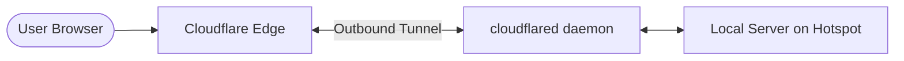

In my engineering classes, a common topic of conversation is the setup we need at home to build, host, and test applications. Many of my peers believe that hosting your own local server requires a high-speed fiber broadband connection, a static IP, and an expensive router. 

I don't have a high-speed home broadband connection. But instead of letting that limit me, I wanted to see if I could work around it using what I had: a standard mobile data plan, a hotspot connection, and some modern routing tools.

Here is how I set up my own local server and made it accessible to the public internet without traditional home Wi-Fi or port forwarding.

---

## The Core Obstacle: Carrier-Grade NAT (CGNAT)

When you connect your laptop to a mobile hotspot, your cellular provider assigns you a private IP address behind a **Carrier-Grade NAT (CGNAT)**. 

Because of this:
1. You do not have a public IP address.
2. You cannot access your router's settings to perform traditional port forwarding.
3. Incoming connections from the internet are blocked by the mobile carrier.

To make a local server public under these constraints, we need a way to build an *outbound* connection from the server to the internet that acts as a secure entry point. That is where **Cloudflare Tunnels** come in.

---

## The Architecture

Instead of opening a port for incoming traffic, we run a lightweight daemon (`cloudflared`) on our local machine. This daemon establishes a secure, outbound connection to Cloudflare’s nearest edge server. 

When a user visits your domain, Cloudflare routes the traffic through this established tunnel directly to your local server port.



---

## Step-by-Step Setup

Here is the exact setup I used to get it running:

### 1. Spin up the Local Server
I started a simple web server on my laptop (for example, a basic Node.js or Python server running on port `3000`):

```bash
# A quick Python server to test
python -m http.server 3000
```

### 2. Install Cloudflared
Next, I installed Cloudflare's tunnel client on my machine. 

```bash
# On Windows via winget
winget install Cloudflare.cloudflared
```

### 3. Authenticate and Bind a Domain
Using the CLI, I logged into my Cloudflare account to link my custom domain:

```bash
cloudflared tunnel login
```

This opens a browser tab allowing you to authorize your domain. Once logged in, I created the tunnel:

```bash
cloudflared tunnel create my-hotspot-tunnel
```

### 4. Route and Run
Configuring the tunnel to route public domain traffic directly to my local port `3000`:

```bash
# Route traffic from subdomain.shrivibhavan.com to the tunnel
cloudflared tunnel route dns my-hotspot-tunnel server.shrivibhavan.com

# Run the tunnel pointing to the local port
cloudflared tunnel run --url http://localhost:3000 my-hotspot-tunnel
```

Immediately, traffic to `server.shrivibhavan.com` was routed securely over my mobile hotspot directly to my laptop's local server.

---

## What I Learned

This experiment taught me that resource constraints don't have to define what you can build. While having a high-speed fiber connection at home is convenient, modern tools like Cloudflare Tunnels have democratized hosting. 

If you are a student or developer facing similar network limitations, I encourage you to try this out. You don't need the perfect setup to start building — you just need to explore different ways to solve the problem.
